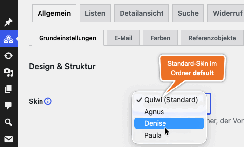

# Skins – Grundlagen

Ein *Skin* ist – technisch gesehen – ein **Ordner**, der alle Ressourcen in (möglichst) einheitlicher und strukturierter Form enthält, die für die Darstellung der **Plugin-Frontend- und Mail-Komponenten** maßgeblich sind:

- Templates (PHP, Twig)
- JavaScript-Dateien
- CSS-Dateien
- Bilddateien
- Fonts

?> Der *Plugin-Kern* enthält zusätzliche, oft versionsspezifische Dateien dieser Art, die für die Bereitstellung grundlegender Funktionalitäten obligatorisch sind und daher 1:1 eingebunden werden müssen.

Analog zu WordPress-Parent-Themes und hieraus abgeleiteten Child-Themes wird im „Kickstart-Kosmos“ grundsätzlich zwischen den in den Plugins enthaltenen *Standard-Skins* und individuell angepassten *Custom Skins* unterschieden.

## Standard-Skin

Sowohl das Kickstart-Basis-Plugin als auch die hierauf aufbauenden [Add-ons](/add-ons) enthalten ein *Standard-Skin* im Unterordner `skins/default` des jeweiligen Plugin-Verzeichnisses:

Basis-Plugin: <code>.../wp-content/plugins/<strong>immonex-kickstart</strong>/skins/default</code>

Add-ons: <code>.../wp-content/plugins/<strong>ADD-ON-ORDNERNAME</strong>/skins/default</code>

Beispiel [Team Add-on](https://de.wordpress.org/plugins/immonex-kickstart-team/): <code>.../wp-content/plugins/<strong>immonex-kickstart-team</strong>/skins/default</code>

Das Standard-Skin ist die [Basis für individuelle Anpassungen](#individuelle-anpassung) in Form von eigenen Skins, die als *Custom Skins* bezeichnet werden.

## Custom Skins

Alle Dateien eines Custom Skins werden *update-sicher* in einem eigenen Ordner im **(Child-)Theme-Verzeichnis** hinterlegt.

!> Angepasste Skin-Dateien dürfen **nicht** direkt in einem der o. g. **Plugin-Verzeichnisse** oder dem Ordner eines regelmäßig aktualisierten **Parent-Themes** (*Haupt-Theme*) gespeichert werden, da diese beim nächsten Update überschrieben oder entfernt werden würden.

Für eigene Skins, die sich auf die Frontend-Komponenten des Basis-Plugins beziehen, ist der (Child-)Theme-Unterordner `immonex-kickstart` der passende Speicherort:

<code>.../wp-content/themes/(CHILD-)THEME-NAME/<strong>immonex-kickstart</strong>/SKIN-NAME</code>

Beispiele:

<code>.../wp-content/themes/hello-elementor/immonex-kickstart/<strong>default</strong></code>\
↳ Ordnername `default` entspricht dem des Standard-Skins → keine explizite Auswahl in den Optionen nötig (siehe Folgeabschnitt)

`.../wp-content/themes/hello-elementor/immonex-kickstart/my-custom-skin`

Für Custom **Add-on** Skins entsprechend: 

<code>.../wp-content/themes/(CHILD-)THEME-NAME/<strong>ADD-ON-ORDNERNAME</strong>/SKIN-NAME</code>

Beispiele anhand des [Team Add-ons](https://de.wordpress.org/plugins/immonex-kickstart-team/):

`.../wp-content/themes/hello-elementor/immonex-kickstart-team/default`

`.../wp-content/themes/hello-elementor/immonex-kickstart-team/my-custom-skin`

## Auswahl

Sind Custom Skins für das **Basis-Plugin** vorhanden, kann das anzuwendende Skin unter ***immonex → Einstellungen → Allgemein → Grundeinstellungen [Design & Struktur]*** ausgewählt werden.

Ausnahme: Entspricht der Custom-Skin-Ordnername dem des Standard-Skins (`default`), ist keine explizite Auswahl nötig.

(Die Auswahl von **Add-on-Skins** erfolgt separat in den Optionstabs der jeweiligen Erweiterungen.)

 \
 [Skin-Auswahl](/schnellstart/einrichtung#skin) (Basis-Plugin) in den Plugin-Optionen

?> Die in der Auswahlliste angezeigten Skin-Namen sind in der in den zugehörigen `index.php`-Dateien hinterlegt ([Details](standard-skin?id=skin-name)) und unabhängig vom Ordnernamen.

Die Ordnerstruktur könnte in diesem Fall so aussehen:

<pre class="tree">
.../wp-content/plugins/immonex-kickstart/skins
╷
└── /default &larr; <em class="token important">Standard-Skin</em>

.../wp-content/themes/(CHILD-)THEME-NAME/immonex-kickstart &larr; <em class="token important">Custom-Skin-Stammordner</em>
╷
├── /agnus
├── /denise
└── /paula
</pre>

## CSS und JavaScript

Die Dateien `index.css` und `index.js` des aktiven Skins werden im Frontend automatisch eingebunden.

<pre class="tree">
skin-name
╷
├── /css
│   ╷
│   └── index.css
│
├── /js
│   ╷
│   └── index.js
…
</pre>

Das gilt auch für weitere Dateien (in den gleichen Ordnern) mit den folgenden Namen, sofern vorhanden:

- `extend.css` / `extend.js`
- `custom.css` / `custom.js`
- `frontend.css` / `frontend.js`
- `skin.css` / `skin.js`

Sollen also bspw. per Custom Skin CSS-Regeln und JS-Code ergänzt, die entsprechenden Ressourcen des Standard-Skins aber unverändert mit eingebunden werden, können hierfür die `extend`-Varianten verwendet werden:

<pre class="tree">
…
╷
├── /css
│   ╷
│   └── <strong>extend.css</strong>
│
├── /js
│   ╷
│   └── <strong>extend.js</strong>
…
</pre>

Je nach Umfang bietet es sich an, bei der **Entwicklung** mit mehreren Quelldateien zu arbeiten, die anschließend per Bundler bzw. Präprozessor à la [webpack](https://webpack.js.org/), [Sass](https://sass-lang.com/) & Co. kompiliert werden. Die *kompilierten und/oder minimierten* Varianten der Dateien werden in diesem Fall im alternativen Ordner `assets` gespeichert:

<pre class="tree">
…
╷
├── <strong>/assets</strong>
│   ╷
│   ├── extend.css
│   └── extend.js
…
</pre>

Auch die Aufteilung der CSS- und JS-Dateien in separate Unterordner ist hier möglich:

<pre class="tree">
…
╷
├── /assets
│   ╷
│   ├── <strong>/css</strong>
│   │   ╷
│   │   ├── extend.css
│   │   …
│   │
│   └── <strong>/js</strong>
│       ╷
│       ├── extend.js
…       …
</pre>    

Jede der o. g. CSS/JS-Dateien wird nur **einmalig** eingebunden. Sind mehrere Dateien gleichen Namens im Skin-Ordner enthalten, erfolgt die entsprechende Priorisierung anhand der **Unterordner** in dieser Reihenfolge:

- `assets/css` / `assets/js`
- `assets`
- `css` / `js`

Ist also bspw. eine Datei `custom.css` in den Unterordnern `assets` **und** `css` enthalten, wird nur die Variante im Ordner `assets` im Website-Frontend geladen.

## Individuelle Anpassung

Viele optische Anpassungen können bereits auf Basis eines [individuellen Farbschemas](farben), eigener CSS-Regeln (z. B. via [Customizer](css) bzw. `styles.css` des Child-Themes) oder mittels [Filterfunktionen](filters-actions?id=filter) umgesetzt werden.

Ist dieser Rahmen für **grundlegende** Änderungen – bspw. bei sehr speziellen Layoutvorgaben – zu begrenzt, ermöglicht der Einsatz eines [Custom Skins](standard-skin) die Modifizierung der für das Rendering der Frontend-Komponenten maßgeblichen Template-Dateien auf Code-Ebene (PHP/Twig/JavaScript/CSS).

Als Grundlage hierfür können die entsprechenden Dateien aus dem [Entwicklungs-Repository](https://github.com/immonex/kickstart/tree/master/src/skins/default) übernommen werden – im Falle von PHP- oder Twig-Templates **alternativ** auch aus dem Unterordner `skins/default` des Basis-Plugin- bzw. Add-on-Verzeichnisses.

Ab Kickstart-Version **1.17.10** gilt für **alle** Custom Skins, dass diese nur noch die Dateien enthalten müssen, deren Inhalte von denen der gleichnamigen Dateien des Standard-Skins abweichen. Auf letzteres wird automatisch als *Fallback* zurückgegriffen.

!> Bei Plugin-Versionen **vor 1.17.10** war die oben beschriebene Fallback-Logik nur bei Skins gegeben, die direkt vom Standard-Skin abgeleitet waren (→ Ordnername: `default`). Diese Unterscheidung zwischen *partiellen und vollständigen Custom Skins* kann bei Bedarf über den Filter-Hook [inx_use_default_skin_assets_as_fallback](filter-inx-use-default-skin-assets-as-fallback) reaktiviert werden.

### Beispiel

Soll nur das Layout der Listenansichten geändert werden, muss der Custom-Skin-Ordner im einfachsten Fall nur die Template-Datei `property-list/properties.php` enthalten.

<pre class="tree">
.../wp-content/themes/(CHILD-)THEME-NAME/immonex-kickstart
╷
└── /<strong>default</strong> &larr; <em class="token important">Standard-Skin-Variante</em>
    ╷
    └── /property-list
        ╷
        └── properties.php
</pre>

Am Ordnernamen `default` ist zu erkennen, dass es sich hier um eine individuell angepasste Variante des Standard-Skins handelt, d. h. diese muss weder explizit in den Plugin-Optionen ausgewählt noch mit einem eigenen Namen versehen werden.

Wird mit mehreren Custom Skins gearbeitet, können die jeweiligen Ordner sowie die Skins selbst (siehe unten) beliebig benannt werden.

<pre class="tree">
.../wp-content/themes/(CHILD-)THEME-NAME/immonex-kickstart
╷
└── <strong>/my-custom-skin</strong> &larr; <em class="token important">beliebiger Ordnername</em>
    ╷
    ├── /assets
    │   ╷
    │   └── index.css
    │
    ├── /property-list
    │   ╷
    │   ├── list-item.php
    │   └── properties.php
    │
    └── index.php &larr; <em class="token important">enthält den Skin-Namen</em>
</pre>

!> Dateien und Ordner, die nur für die Entwicklung relevant sind (Dev-Konfiguration, zu kompilierende SCSS- und JavaScript-Quelldaten etc.) sollten in der final veröffentlichten Version des Skins (Produktivserver/Live-Website) **nicht** enthalten sein.

Hier geht's weiter: [Standard-Skin im Detail](standard-skin)
