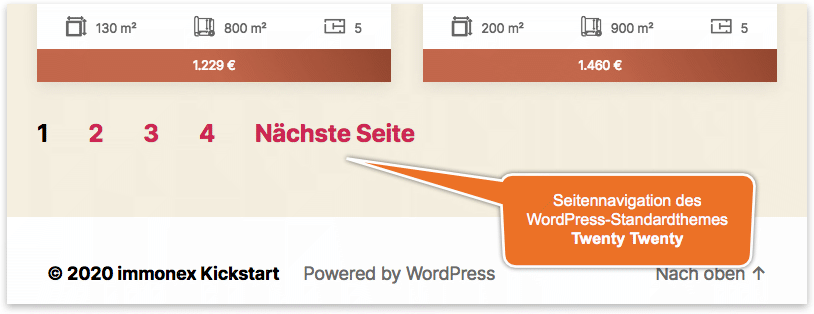
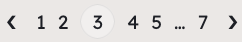

# Seitennavigation

Wie die Auswahl der Sortierreihenfolge wird auch die Seitennavigation immer in Kombination mit einer [Immobilien-Listenansicht](liste) eingebunden.

Layout und Design werden *in den meisten Fällen* vom **aktiven Theme** vorgegeben, um eine einheitliche Darstellung innerhalb der Website zu gewährleisten.

\
Seitennavigation des WordPress-Standard-Themes *Twenty Twenty*

Ist **keine** *themeseitige* Formatierung vorgesehen, kann mit der Auswahl von *Kickstart (Standard)* als grundlegendem Stil in den [Plugin Optionen](/schnellstart/einrichtung?id=seitennavigation) (***immonex → Einstellungen → Listen → Seitennavigation***) die folgende Darstellung umgesetzt werden:

Im genannten Optionstab oder mittels der u. g. Shortcode-Attribute können neben diesem auch noch weitere Parameter der Seitennavigation angepasst werden.

?> Ist der beliebte Page/Site Builder [Elementor](https://de.wordpress.org/plugins/elementor/) im Einsatz, kann die Seitennavigation – alternativ zur nachfolgend beschriebenen Shortcode-Variante – auch per [Elementor-Widget](https://docs.immonex.de/kickstart-for-elementor/#/elementor-immobilien-widgets/seitennavigation) eingebunden und konfiguriert werden. Voraussetzung hierfür ist das kostenfreie [Kickstart for Elementor Add-on](https://de.wordpress.org/plugins/immonex-kickstart-for-elementor/).

## Shortcode

`[inx-pagination]`

### Attribute

Alternativ zu den *globalen* [Plugin Optionen](/schnellstart/einrichtung?id=seitennavigation) können die Standardwerte der gleichnamigen Parameter der WP-Paginierungsfunktionen [get_the_posts_pagination](https://developer.wordpress.org/reference/functions/get_the_posts_pagination/) und [paginate_links](https://developer.wordpress.org/reference/functions/paginate_links/) auch direkt via Shortcode überschrieben werden.

| Name | Beschreibung |
| ---- | ------------ |
| `style` (string) | *standard* = Kickstart-Standardstil (siehe oben) |
| `show_all` (bool) | alle Seitenzahlen anzeigen (*true* oder *1*, Standard: *false*) |
| `end_size` (int) | Anzahl der Zahlen am Anfang und Ende der Seitenzahlenlisten (Standard: *1*) |
| `mid_size` (int) | Anzahl der Zahlen unmittelbar vor und hinter der aktuellen Seitenzahl (Standard: *2*) |
| `prev_next` (bool) | Vor/Zurück-Navigation (*false* oder *0* zum Ausblenden, Standard: *true*) |
| `prev_text` (string) | Zurück-Linktext (Standard: *Vorherige Seite*) |
| `next_next` (string) | Vor-Linktext (Standard: *Nächste Seite*) |
| `add_fragment` (string) | Zeichenkette, die an jede Seiten-Navigations-URL angehangen werden soll |
| `before_page_number` (string) | Text vor jeder Seitenzahl |
| `after_page_number` (string) | Text nach jeder Seitenzahl |
| `screen_reader_text` (string) | Screen-Reader-Text für das Navigationselement (Standard: *Seitennummerierung der Beiträge*) |
| `aria_label` (string) | ARIA-Label für das Navigationselement (Standard: *Seitennummerierung der Beiträge*) |
| `class` (string) | individuelle Klasse für das Navigations-Container-Element (Standard: *pagination*) |
| `pagination_template` (string) | alternative PHP-Template-Datei im [Skin-Ordner](/anpassung-erweiterung/skins) (Standard: *property-list/pagination*) |
| `no_top_margin` (bool) | *1* = **kein** größerer Außenabstand oben |
| `no_standard_container_class` (bool) | *1* = Standard-Containerklasse (`.inx-container`) für das Rahmenelement **deaktivieren** |

#### Beispiele

Navigation mit allen Seitenzahlen und ohne Vor/Zurück-Links:\
`[inx-pagination show_all="true" prev_next="false"]`

Navigation mit Pfeilen (UTF-8) anstatt der Vor/Zurück-Textlinks:\
`[inx-pagination prev_text="🢀" next_text="🢂"]`

Navigation im *Kickstart-Standardstil* (siehe oben):\
`[inx-pagination style="standard"]`

## Erweiterte Anpassungen

- [Filter-Referenz](/anpassung-erweiterung/filters-actions?id=seitennavigation-paginierung)
- [Templates](/anpassung-erweiterung/skins)
- [Custom Skin](/anpassung-erweiterung/standard-skin#archiv-amp-listenansicht)